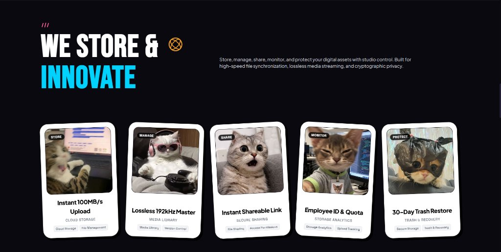

# Cloudora

Cloudora is a modern cloud storage and digital asset management platform engineered for speed, privacy, and minimalist aesthetics. Built with a React 18, Vite, and TypeScript frontend alongside an Express.js backend, Cloudora delivers a streamlined workspace for managing, streaming, and sharing media and files.

<p align="center">
  
</p>

---

## Core Capabilities

Cloudora provides a cohesive set of services designed to handle everyday file operations and rich media storage:

* **Store**: High-throughput cloud storage, file hierarchy management, and categorized folder organization.
* **Manage**: Dedicated media library for lossless audio, video, and image assets, accompanied by version tracking, metadata filtering, and bulk operations.
* **Share**: Instant shareable links, granular access permissions, and cross-device synchronization.
* **Monitor**: Real-time storage telemetry, upload tracking, transfer queues, and system notifications.
* **Protect**: Cryptographic privacy tolerance, 30-day trash recovery lifecycle, and access-controlled endpoints.

<p align="center">
  
</p>

---

## Design System

Cloudora is styled using a modern architectural aesthetic:
* **Palette**: Pure black (`#07070A`), subtle charcoal surfaces (`#0A0A0E` / `#111116`), and high-contrast crisp white typography.
* **Borderless Layout**: Flat document streams and tables separated exclusively by hairline bottom divider lines (`border-b border-white/[0.06]`), eliminating boxy cards and cluttered borders.
* **Typography & Motion**: Bold condensed display headers paired with smooth marquee tickers and responsive micro-interactions.

---

## Technology Stack

### Frontend
* **Core**: React 18, TypeScript, Vite
* **Styling**: Tailwind CSS, PostCSS, Autoprefixer
* **Icons & UI**: Lucide React
* **State & Routing**: React Router v6, Context API, Axios

### Backend
* **Runtime**: Node.js, Express.js, TypeScript (ts-node-dev)
* **Authentication**: Stateless JSON Web Tokens (JWT), Bcrypt password hashing
* **Validation**: Express middleware for schema validation and role-based guards
* **CORS & Security**: Standard security headers and configured CORS policies

---

## Getting Started

### Prerequisites
* Node.js (v18.0.0 or higher recommended)
* npm or yarn

### Installation

1. Clone the repository:
   ```bash
   git clone https://github.com/UBX-CODE/Cloudora.git
   cd Cloudora
   ```

2. Install backend dependencies:
   ```bash
   cd server
   npm install
   ```

3. Install frontend dependencies:
   ```bash
   cd ../client
   npm install
   ```

### Running Locally

1. Start the authentication backend:
   ```bash
   cd server
   npm run dev
   ```
   The backend API will run on `http://localhost:5000`.

2. Start the Vite client application in a separate terminal:
   ```bash
   cd client
   npm run dev
   ```
   The web application will be accessible at `http://localhost:5173`.

---

## Authentication Endpoints

| Method | Endpoint | Description | Auth Required |
|---|---|---|---|
| POST | `/api/auth/register` | Register a new user account | No |
| POST | `/api/auth/login` | Authenticate user and receive JWT token | No |
| GET | `/api/auth/me` | Fetch authenticated user profile | Bearer Token |
| GET | `/api/health` | Service health status check | No |

---

## License

This project is licensed under the MIT License.
